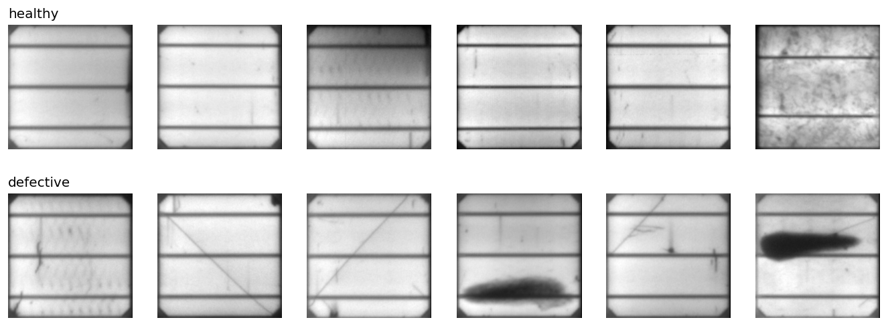
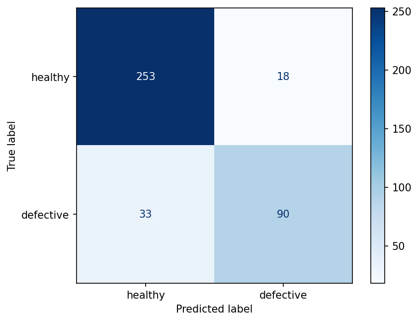
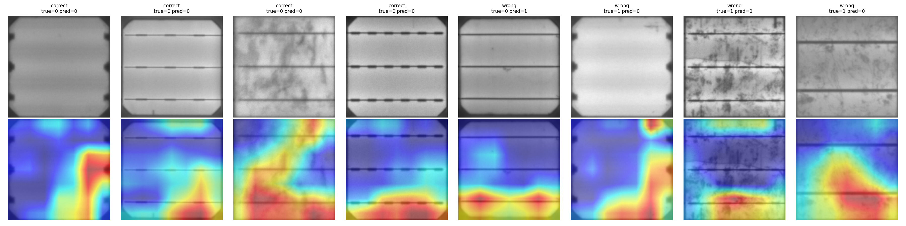

# Finding defective solar cells in electroluminescence images

A deep learning study that sorts 2,624 solar cell images into healthy and defective, and checks honestly where it succeeds and where it fails.

| ResNet18 macro-F1 | Defective cells caught | Held-out test images |
| --- | --- | --- |
| **0.862** (mean of 3 seeds) | **78%** | **394** |



*Illustration only: cells with a bright crack are defective, a dark edge is a dead region.*

## What this project does

Electroluminescence (EL) imaging makes a working solar cell glow and shows damage as dark or broken areas. Inspecting thousands of cells by eye is slow, so this project trains neural networks to label each cell image as healthy or defective.

It uses the public ELPV dataset: 2,624 grayscale 300×300 cell images, 1,550 polycrystalline and 1,074 monocrystalline. Each image carries a defect likelihood of 0, 0.33, 0.67 or 1.0. I treat 0 and 0.33 as healthy and 0.67 and 1.0 as defective, giving 1,803 healthy and 821 defective cells (31% defective). That threshold is my choice, and a different one would change the results.

## How it was built

**Data**
- Stratified 70/15/15 split: 1,836 train, 394 validation, 394 test
- Fixed split seed, identical for every model
- Test set used only for final scoring

**Models**
- Majority-class baseline
- Small 4-block CNN trained from scratch
- ImageNet-pretrained ResNet18, head trained first, then fine-tuned

**Training**
- Class-weighted cross-entropy, AdamW
- Flip, rotation and brightness augmentation on training data only
- Best checkpoint chosen by validation macro-F1

Trained on a MacBook Air M2 using PyTorch's MPS backend.

## Results on the test set

| Model | Accuracy | Macro-F1 | Defective recall | Defective precision |
| --- | --- | --- | --- | --- |
| Majority baseline | 0.688 | 0.408 | 0.000 | n/a |
| Small CNN (1 seed) | 0.736 | 0.715 | 0.748 | 0.558 |
| ResNet18 (mean of 3 seeds) | 0.883 | 0.862 | 0.783 | 0.833 |

ResNet18 macro-F1 ranged from 0.844 to 0.881 across seeds.

Always predicting "healthy" scores 69% accuracy while finding no defects at all. That is why macro-F1 and defective recall matter more than accuracy here.



## Where the model fails

Errors are not spread evenly. Cells with an uncertain 0.33 or 0.67 label are 14% of the test set but cause 41% of the mistakes.

| Original label | Test images | Errors | Error rate |
| --- | --- | --- | --- |
| 0.00, clearly healthy | 230 | 8 | 3.5% |
| 0.33, uncertain | 41 | 10 | 24.4% |
| 0.67, uncertain | 13 | 11 | 84.6% |
| 1.00, clearly defective | 110 | 22 | 20.0% |

Label ambiguity explains part of the problem, not all of it: one in five clearly defective cells is still missed. These figures come from one seed, and only 13 test images carry the 0.67 label, so treat them as indicative.

Grad-CAM view of what the ResNet18 looks at:



## Limitations

- The dataset has no module IDs, so cells from the same panel may land in different splits. That could inflate scores.
- One data split. Seeds vary training randomness only, not the split.
- About one in five defective cells is missed, which matters for real inspection.
- One dataset, one image type, cell-level only, with no field testing.
- The CNN baseline is a single untuned run.

## Project structure

```
src/        data loading, models, training, evaluation, Grad-CAM, error analysis
outputs/    confusion matrices, misclassified-image lists, Grad-CAM, sample images
webapp/     small web demo (app.py, static/index.html, trained ResNet18 weights)
```

## How to run

```bash
git clone https://github.com/amitjaswal040106-eng/solar-defect.git
cd solar-defect
pip install -r requirements.txt
```

Training and evaluation scripts are in `src/` (`train.py`, `evaluate.py`, `gradcam.py`). The web demo is in `webapp/`:

```bash
cd webapp
pip install -r requirements.txt
python app.py
```

## References

- Buerhop-Lutz et al., 2018. A Benchmark for Visual Identification of Defective Solar Cells in Electroluminescence Imagery. 35th EU PVSEC.
- Deitsch et al., 2019. Automatic classification of defective photovoltaic module cells in electroluminescence images. Solar Energy 185 (arXiv:1807.02894).
- He et al., 2016. Deep Residual Learning for Image Recognition (arXiv:1512.03385).
- Selvaraju et al., 2017. Grad-CAM (arXiv:1610.02391).

Student project. Results are from my own runs on the ELPV dataset and are not evidence of field performance.
